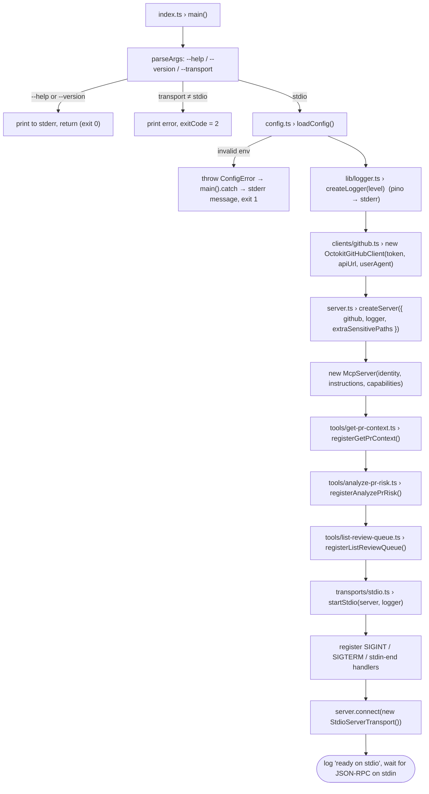
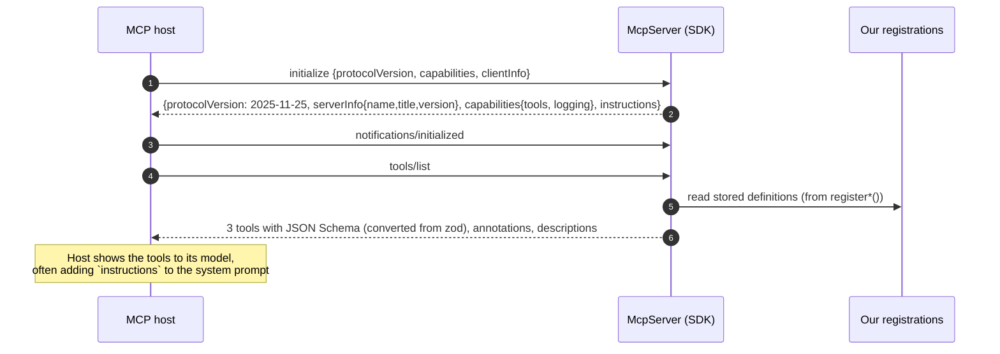
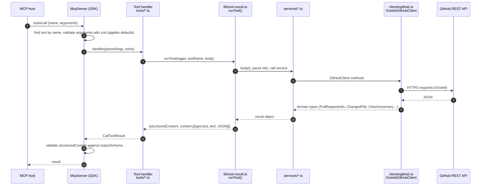
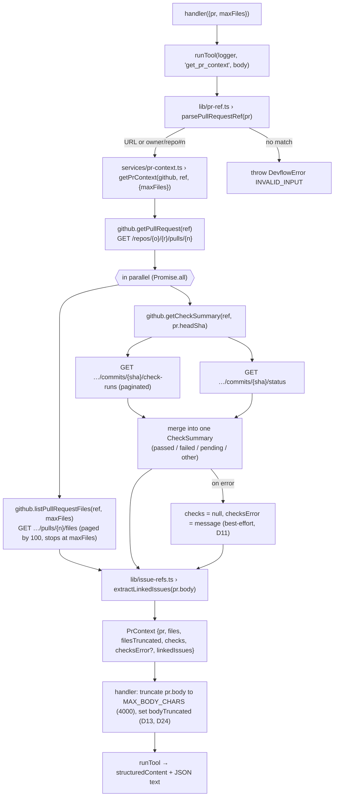
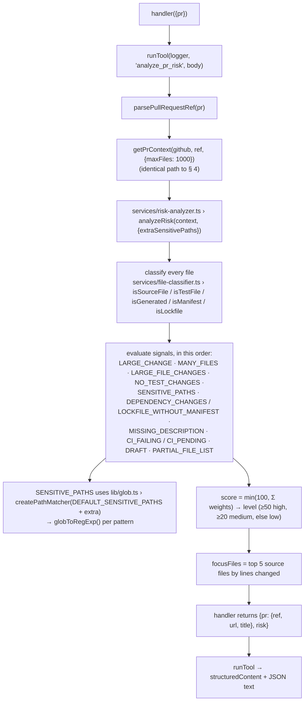
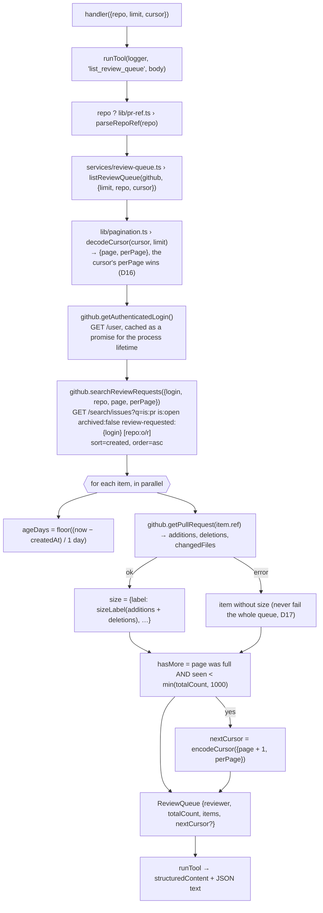
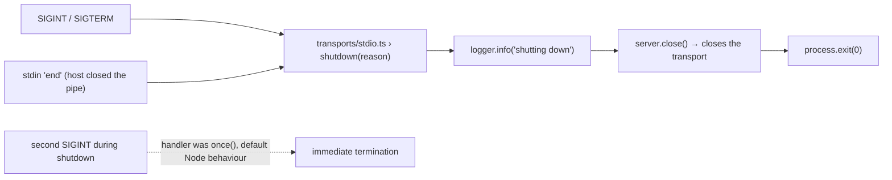

# Flow

How execution moves through DevFlow MCP, from process start to a tool result and back, file by
file and function by function.

- **Why** things are built this way: [Decisions.md](Decisions.md) (cited as D1–D24).
- **How the code is organised** (layers, folders): [ARCHITECTURE.md](ARCHITECTURE.md).

**Reading the diagrams:** `file.ts › function()` names the code that runs. Boxes marked _SDK_ are
inside `@modelcontextprotocol/sdk`, not our code. Diagrams use Mermaid, which renders on GitHub
and in VS Code's Markdown preview.

## Contents

1. [Startup](#1-startup)
2. [Handshake and discovery](#2-handshake-and-discovery)
3. [The shared `tools/call` pipeline](#3-the-shared-toolscall-pipeline)
4. [`get_pr_context`](#4-get_pr_context)
5. [`analyze_pr_risk`](#5-analyze_pr_risk)
6. [`list_review_queue`](#6-list_review_queue)
7. [Error paths](#7-error-paths)
8. [Shutdown](#8-shutdown)
9. [Test and tooling flows](#9-test-and-tooling-flows)
10. [GitHub API calls per tool](#10-github-api-calls-per-tool)
11. [Function index](#11-function-index)

---

## 1. Startup

The MCP host (Claude Code, Claude Desktop, VS Code) starts `node dist/index.js` as a child
process with `GITHUB_TOKEN` in its environment.



| Step | Where                                    | What happens                                                                                                  | Why                                                                                              |
| ---- | ---------------------------------------- | ------------------------------------------------------------------------------------------------------------- | ------------------------------------------------------------------------------------------------ |
| 1    | `src/index.ts › main()`                  | Parses CLI flags. `--help` and `--version` print to **stderr** and return.                                    | stdout is reserved for the protocol (D14)                                                        |
| 2    | `src/config.ts › loadConfig()`           | zod validates `process.env` into a typed `Config`. All problems are reported at once.                         | Fail fast, before a host thinks we're healthy (D15)                                              |
| 3    | `src/lib/logger.ts › createLogger()`     | pino JSON logger on file descriptor 2, with token redaction.                                                  | D14                                                                                              |
| 4    | `src/clients/github.ts › constructor`    | Builds the Octokit instance (auth, GHES `baseUrl`, silenced console logger). **No network call yet.**         | Startup stays fast and offline. A bad token surfaces on the first tool call as `[UNAUTHORIZED]`. |
| 5    | `src/server.ts › createServer()`         | Creates `McpServer` with name/title/version, `instructions`, and the `logging` capability; registers 3 tools. | Transport-agnostic factory, reused by tests (D3, D19)                                            |
| 6    | `src/tools/*.ts › register*()`           | Each calls `server.registerTool(name, {description, inputSchema, outputSchema, annotations}, handler)`.       | Registration only stores the definitions; nothing executes yet                                   |
| 7    | `src/transports/stdio.ts › startStdio()` | Installs shutdown handlers, then `server.connect()` starts reading stdin.                                     | Handlers first, so a signal during startup is still handled                                      |

`index.ts` is the **composition root**: the only place that creates concrete classes. Every other
module receives its dependencies through the `ToolContext` object (`src/tools/context.ts`).

## 2. Handshake and discovery

All of this happens inside the SDK, driven by data we provided in `createServer()`.



- **Version negotiation:** the SDK answers with `2025-11-25` or the newest version the host also
  supports (back to `2024-11-05`).
- **`instructions`** (`src/server.ts › INSTRUCTIONS`) tell the model which tool to use when, and to
  treat PR text as untrusted (D13).
- **Schemas:** the zod shapes in `src/tools/*.ts` and `src/tools/schemas.ts` are converted to JSON
  Schema by the SDK. The `.describe()` texts become the field descriptions the model reads.
- **`logging/setLevel`:** answered automatically by the SDK because we declared `logging`.

## 3. The shared `tools/call` pipeline

Every tool call follows the same path. The tool-specific part is only the box in the middle.



| Stage             | Code                                             | Responsibility                                                                                                 |
| ----------------- | ------------------------------------------------ | -------------------------------------------------------------------------------------------------------------- |
| Input validation  | SDK (`McpServer.validateToolInput`)              | Rejects bad arguments before our code runs; fills defaults (`maxFiles = 100`, `limit = 10`)                    |
| Handler           | `src/tools/<tool>.ts`, arrow fn in `register*()` | Converts strings to typed refs (`parsePullRequestRef`, `parseRepoRef`), calls the service, shapes output (D24) |
| Outcome wrapper   | `src/lib/tool-result.ts › runTool()`             | Times the call, logs it, builds success or `isError` results (D6, D8)                                          |
| Business logic    | `src/services/*.ts`                              | Orchestrates client calls, applies rules; knows nothing about MCP                                              |
| External I/O      | `src/clients/github.ts › OctokitGitHubClient`    | HTTP, pagination, mapping raw JSON to domain types and HTTP errors to `DevflowError` (D7, D8, D10)             |
| Output validation | SDK (`McpServer.validateToolOutput`)             | Guarantees `structuredContent` matches the published `outputSchema` (skipped for `isError` results)            |

## 4. `get_pr_context`

**Entry:** `src/tools/get-pr-context.ts › registerGetPrContext` handler · **Arguments:** `pr`, `maxFiles` (1–300, default 100)



**Ordering detail:** `getPullRequest` must finish first because the CI lookup needs `pr.headSha`.
Files and CI are independent, so they run concurrently. CI failures are caught _inside_ the
`Promise.all` (via `.then(ok, fail)`) so they can't discard the file list.

## 5. `analyze_pr_risk`

**Entry:** `src/tools/analyze-pr-risk.ts › registerAnalyzePrRisk` handler · **Arguments:** `pr`



`analyzeRisk()` is **pure**: no I/O, no clock, no randomness, so the same input always gives the
same report (D12). All network work happens in the shared `getPrContext()` step.

## 6. `list_review_queue`

**Entry:** `src/tools/list-review-queue.ts › registerListReviewQueue` handler · **Arguments:** `repo?`, `limit` (1–30, default 10), `cursor?`



**Pagination round-trip:** the model passes `nextCursor` back as `cursor` and the flow repeats
from `decodeCursor`. The 1000-item cap exists because GitHub search refuses pages past 1000 results.

## 7. Error paths

Where each kind of failure starts, and what the host sees in the end.

| #   | Trigger                                  | Raised at                                                      | Becomes                                                               | Host sees                                                                   |
| --- | ---------------------------------------- | -------------------------------------------------------------- | --------------------------------------------------------------------- | --------------------------------------------------------------------------- |
| E1  | Missing/invalid env var at startup       | `config.ts › loadConfig()` → `ConfigError`                     | `main().catch` prints the message to stderr, `exit(1)`                | Server failed to start; message in the host's MCP logs                      |
| E2  | Unknown tool name                        | SDK                                                            | SDK tool error                                                        | `isError: true`, "Tool X not found"                                         |
| E3  | Arguments violate input schema           | SDK `validateToolInput`                                        | SDK tool error                                                        | `isError: true`, "Input validation error: …"                                |
| E4  | Malformed PR/repo string or cursor       | `pr-ref.ts` / `pagination.ts` → `DevflowError(INVALID_INPUT)`  | `runTool` catch                                                       | `isError: true`, `[INVALID_INPUT] … Use a URL like …`                       |
| E5  | GitHub 401/403/404/422/429/5xx           | Octokit → `errors.ts › mapGitHubError()` in each client method | `DevflowError` with code → `runTool` catch                            | `isError: true`, e.g. `[NOT_FOUND] Could not find … Check …`                |
| E6  | Rate limited (403 + remaining 0, or 429) | `mapGitHubError()` reads `x-ratelimit-*` headers               | `DevflowError(RATE_LIMITED)` including the reset time                 | `isError: true`, `[RATE_LIMITED] … resets at <ISO time>`                    |
| E7  | CI lookup fails                          | `getCheckSummary()`                                            | Caught in `getPrContext()`, **not** an error                          | Success, with `checks: null` and `checksError` explaining why (D11)         |
| E8  | One PR's size lookup fails in the queue  | `getPullRequest()` inside `listReviewQueue()`                  | Caught per item, **not** an error                                     | Success; that item has no `size` (D17)                                      |
| E9  | Bug / unexpected exception               | anywhere                                                       | `runTool` catch → `logger.error` with stack                           | `isError: true`, `[INTERNAL] Unexpected internal error…` (no internals, D8) |
| E10 | Our output doesn't match `outputSchema`  | SDK `validateToolOutput`                                       | SDK tool error (prevented at compile time by `SchemaDriftChecks`, D7) | `isError: true`, "Output validation error: …"                               |

Every `DevflowError` path goes through `runTool()`, so the message format (`[CODE] message`) and
logging (`warn` level with `tool`, `ms`, `code`) are always the same.

## 8. Shutdown



## 9. Test and tooling flows

The same production code runs under different wiring.

**Integration tests** (`test/integration/server.test.ts`)

```
FakeGitHubClient (test/helpers/fixtures.ts)  ─┐
createSilentLogger()                          ├─► createServer(ctx) ─► server.connect(serverTransport)
extraSensitivePaths: []                       ─┘                                   ▲
                                                InMemoryTransport.createLinkedPair()
new Client() (SDK) ─► client.connect(clientTransport) ─► client.callTool(…)  ── § 3 pipeline ──┘
```

This exercises everything in §§ 2–7 except `OctokitGitHubClient` and the stdio transport.

**Adapter tests** (`test/unit/github-client.test.ts`): `new OctokitGitHubClient()` → real Octokit →
native `fetch` → **msw** `setupServer()` returns canned GitHub JSON. This covers the box at the bottom
of § 3.

**Live smoke** (`scripts/smoke.ts`, `npm run smoke -- <pr>`): the SDK `Client` with
`StdioClientTransport` spawns `node dist/index.js`, which runs § 1, then calls all three tools
against real GitHub. This is the only flow that covers the built artifact and stdio together.

**MCP Inspector** (`npm run inspect`): a manual, visual run of §§ 1–6.

## 10. GitHub API calls per tool

| Tool                | Requests                                                                                                                | Typical total |
| ------------------- | ----------------------------------------------------------------------------------------------------------------------- | ------------- |
| `get_pr_context`    | `pulls.get` ×1 · `pulls.listFiles` ×⌈files/100⌉ · `checks.listForRef` ×⌈runs/100⌉ · `repos.getCombinedStatusForRef` ×1  | 4             |
| `analyze_pr_risk`   | Same as `get_pr_context` (up to 1000 files, so up to 10 file pages)                                                     | 4             |
| `list_review_queue` | `users.getAuthenticated` ×1 (first call per process only) · `search.issuesAndPullRequests` ×1 · `pulls.get` ×N (N ≤ 30) | 2 + N         |

Budget: 5,000 core requests/hour and 30 search requests/minute for an authenticated user.

## 11. Function index

Who calls what. Use it to find the impact of changing a function.

| Function                                                                    | File                              | Called by                                    | Calls                                                                                                          |
| --------------------------------------------------------------------------- | --------------------------------- | -------------------------------------------- | -------------------------------------------------------------------------------------------------------------- |
| `main`                                                                      | `src/index.ts`                    | Node (process start)                         | `loadConfig`, `createLogger`, `OctokitGitHubClient`, `createServer`, `startStdio`                              |
| `loadConfig`                                                                | `src/config.ts`                   | `main`, tests                                | zod `EnvSchema.safeParse`                                                                                      |
| `createLogger` / `createSilentLogger`                                       | `src/lib/logger.ts`               | `main` / tests                               | pino                                                                                                           |
| `createServer`                                                              | `src/server.ts`                   | `main`, integration tests                    | `McpServer`, `registerGetPrContext`, `registerAnalyzePrRisk`, `registerListReviewQueue`                        |
| `startStdio`                                                                | `src/transports/stdio.ts`         | `main`                                       | `StdioServerTransport`, `server.connect`, `server.close`                                                       |
| `registerGetPrContext`                                                      | `src/tools/get-pr-context.ts`     | `createServer`                               | handler → `runTool`, `parsePullRequestRef`, `getPrContext`                                                     |
| `registerAnalyzePrRisk`                                                     | `src/tools/analyze-pr-risk.ts`    | `createServer`                               | handler → `runTool`, `parsePullRequestRef`, `getPrContext`, `analyzeRisk`                                      |
| `registerListReviewQueue`                                                   | `src/tools/list-review-queue.ts`  | `createServer`                               | handler → `runTool`, `parseRepoRef`, `listReviewQueue`                                                         |
| `runTool`                                                                   | `src/lib/tool-result.ts`          | all three tool handlers                      | the tool body; `logger.info/warn/error`                                                                        |
| `getPrContext`                                                              | `src/services/pr-context.ts`      | `get_pr_context`, `analyze_pr_risk` handlers | `getPullRequest`, `listPullRequestFiles`, `getCheckSummary`, `extractLinkedIssues`                             |
| `analyzeRisk`                                                               | `src/services/risk-analyzer.ts`   | `analyze_pr_risk` handler                    | `is*` classifiers, `createPathMatcher`                                                                         |
| `listReviewQueue`                                                           | `src/services/review-queue.ts`    | `list_review_queue` handler                  | `decodeCursor`, `getAuthenticatedLogin`, `searchReviewRequests`, `getPullRequest`, `sizeLabel`, `encodeCursor` |
| `isSourceFile` / `isTestFile` / `isGenerated` / `isManifest` / `isLockfile` | `src/services/file-classifier.ts` | `analyzeRisk`                                | regexes and sets in the same file                                                                              |
| `getAuthenticatedLogin`                                                     | `src/clients/github.ts`           | `listReviewQueue`                            | `GET /user` (cached), `mapGitHubError`                                                                         |
| `getPullRequest`                                                            | `src/clients/github.ts`           | `getPrContext`, `listReviewQueue`            | `GET /repos/{o}/{r}/pulls/{n}`, `mapGitHubError`                                                               |
| `listPullRequestFiles`                                                      | `src/clients/github.ts`           | `getPrContext`                               | `GET …/pulls/{n}/files` (iterator), `mapGitHubError`                                                           |
| `getCheckSummary`                                                           | `src/clients/github.ts`           | `getPrContext`                               | `GET …/check-runs`, `GET …/status`, `mapGitHubError`                                                           |
| `searchReviewRequests`                                                      | `src/clients/github.ts`           | `listReviewQueue`                            | `GET /search/issues`, `mapGitHubError`                                                                         |
| `mapGitHubError`                                                            | `src/lib/errors.ts`               | every `OctokitGitHubClient` method           | creates `DevflowError`                                                                                         |
| `parsePullRequestRef` / `parseRepoRef`                                      | `src/lib/pr-ref.ts`               | tool handlers                                | regexes; throws `DevflowError(INVALID_INPUT)`                                                                  |
| `formatPullRequestRef`                                                      | `src/lib/pr-ref.ts`               | client error messages, `FakeGitHubClient`    | none                                                                                                           |
| `extractLinkedIssues`                                                       | `src/lib/issue-refs.ts`           | `getPrContext`                               | regex over the PR body                                                                                         |
| `encodeCursor` / `decodeCursor`                                             | `src/lib/pagination.ts`           | `listReviewQueue`                            | base64url JSON                                                                                                 |
| `createPathMatcher` / `globToRegExp`                                        | `src/lib/glob.ts`                 | `analyzeRisk`                                | none                                                                                                           |
| `sizeLabel`                                                                 | `src/services/review-queue.ts`    | `listReviewQueue`                            | none                                                                                                           |

> **Keep this file current:** when a milestone adds a tool, resource or prompt, add a section in
> the style of §§ 4–6, a row to § 10 and rows to § 11. M2 will add resource-read and prompt-get flows.
