# Flow

How execution moves through DevFlow MCP, from process start to a tool result, resource or prompt
and back, file by file and function by function.

- **Why** things are built this way: [Decisions.md](Decisions.md) (cited as D1–D34).
- **How the code is organised** (layers, folders): [ARCHITECTURE.md](ARCHITECTURE.md).

**Reading the diagrams:** `file.ts › function()` names the code that runs. Boxes marked _SDK_ are
inside `@modelcontextprotocol/sdk`, not our code. Diagrams use Mermaid, which renders on GitHub
and in VS Code's Markdown preview.

## Contents

1. [Startup](#1-startup)
2. [Handshake and discovery](#2-handshake-and-discovery)
3. [The shared `tools/call` pipeline](#3-the-shared-toolscall-pipeline)
4. [`get_pr_context`](#4-get_pr_context)
5. [`analyze_pr_risk`](#5-analyze_pr_risk)
6. [`get_pr_diff`](#6-get_pr_diff)
7. [`list_review_queue`](#7-list_review_queue)
8. [`get_my_activity`](#8-get_my_activity)
9. [`generate_release_notes`](#9-generate_release_notes)
10. [Resources: list and read](#10-resources-list-and-read)
11. [Prompts, and the `/review-pr` journey end to end](#11-prompts-and-the-review-pr-journey-end-to-end)
12. [Argument completion](#12-argument-completion)
13. [Logging to the host](#13-logging-to-the-host)
14. [Error paths](#14-error-paths)
15. [Shutdown](#15-shutdown)
16. [Test and tooling flows](#16-test-and-tooling-flows)
17. [GitHub API calls per operation](#17-github-api-calls-per-operation)
18. [Function index](#18-function-index)

---

## 1. Startup

The MCP host (Claude Code, Claude Desktop, VS Code) starts `dist/index.js` as a child process
(directly, through `npx devflow-pr-mcp`, or from the Claude Desktop bundle). `GITHUB_TOKEN` in its
environment is optional; without it the GitHub CLI login is used.

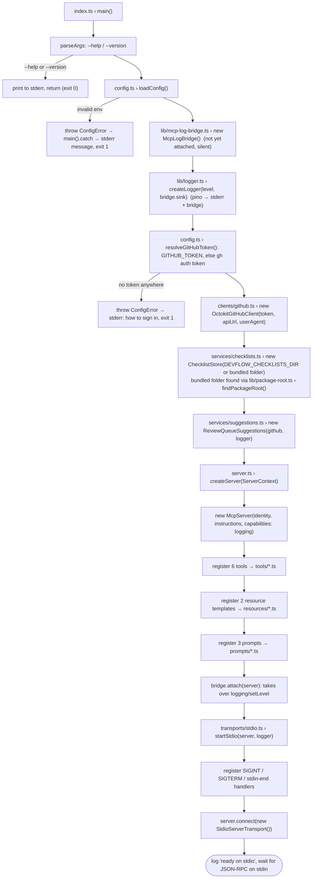

| Step | Where                                      | What happens                                                                                      | Why                                                                                         |
| ---- | ------------------------------------------ | ------------------------------------------------------------------------------------------------- | ------------------------------------------------------------------------------------------- |
| 1    | `src/index.ts › main()`                    | Parses CLI flags. `--help` and `--version` print to **stderr** and return.                        | stdout is reserved for the protocol (D14)                                                   |
| 2    | `src/config.ts › loadConfig()`             | zod validates `process.env` into a typed `Config`. All problems are reported at once.             | Fail fast, before a host thinks we're healthy (D15)                                         |
| 3    | `src/lib/mcp-log-bridge.ts`, `logger.ts`   | The bridge is created first so the logger can hand it every line. It stays silent until attached. | Logs reach both stderr and, later, the host (D28)                                           |
| 3b   | `src/config.ts › resolveGitHubToken()`     | Uses `GITHUB_TOKEN`, else runs `gh auth token` (PATH, then known install paths). Logs the source. | Zero-config setup for anyone signed in to the GitHub CLI (D36)                              |
| 4    | `src/clients/github.ts › constructor`      | Builds the Octokit instance. **No network call yet.**                                             | Startup stays fast and offline. A bad token surfaces on the first call as `[UNAUTHORIZED]`. |
| 5    | `ChecklistStore`, `ReviewQueueSuggestions` | Points the store at a folder (no files read yet); the suggestions cache starts empty.             | Checklists are read lazily, so edits apply live (D27)                                       |
| 6    | `src/server.ts › createServer()`           | Creates `McpServer`, then registers 6 tools, 2 resource templates and 3 prompts.                  | Transport-agnostic factory, reused by tests (D19)                                           |
| 7    | `bridge.attach(server)`                    | Replaces the SDK's `logging/setLevel` handler with ours.                                          | We need to know the host's chosen level (D28)                                               |
| 8    | `src/transports/stdio.ts › startStdio()`   | Installs shutdown handlers, then `server.connect()` starts reading stdin.                         | Handlers first, so a signal during startup is still handled                                 |

`index.ts` is the **composition root**: the only place that creates concrete classes. Every
registration receives its dependencies through one `ServerContext` object (`src/context.ts`).

## 2. Handshake and discovery

All of this happens inside the SDK, driven by what `createServer()` registered.

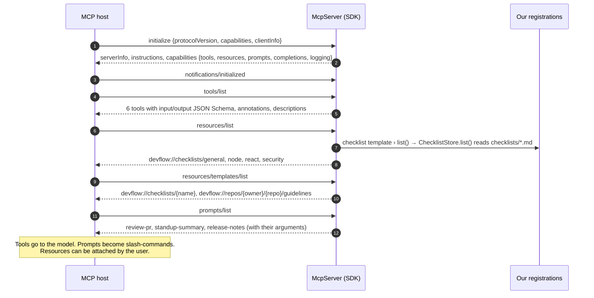

- **Capabilities** `tools`, `resources`, `prompts` and `completions` are added automatically by the
  SDK as things are registered; only `logging` is declared by hand.
- **Version negotiation:** the SDK answers with `2025-11-25` or the newest version the host also
  supports (back to `2024-11-05`).
- **`instructions`** (`src/server.ts › INSTRUCTIONS`) tell the model which tool to use when, and to
  treat author-written text and code as untrusted (D13).
- **Schemas:** the zod shapes in `src/tools/*.ts` and `src/tools/schemas.ts` become JSON Schema.
  The `.describe()` texts become the field descriptions the model reads.

## 3. The shared `tools/call` pipeline

Every tool call follows the same path. The tool-specific part is only the box in the middle.

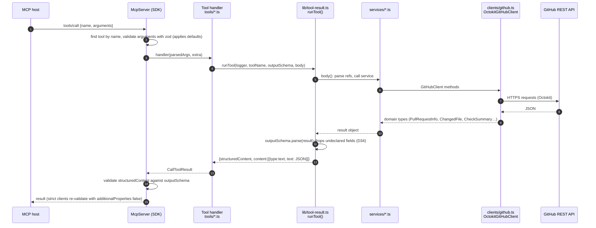

| Stage             | Code                                             | Responsibility                                                                                                 |
| ----------------- | ------------------------------------------------ | -------------------------------------------------------------------------------------------------------------- |
| Input validation  | SDK (`McpServer.validateToolInput`)              | Rejects bad arguments before our code runs; fills defaults (`maxFiles = 100`, `limit = 10`, `days = 1`)        |
| Handler           | `src/tools/<tool>.ts`, arrow fn in `register*()` | Converts strings to typed refs (`parsePullRequestRef`, `parseRepoRef`), calls the service, shapes output (D24) |
| Outcome wrapper   | `src/lib/tool-result.ts › runTool()`             | Parses output through the schema (D34), times and logs the call, builds success or `isError` results (D6, D8)  |
| Business logic    | `src/services/*.ts`                              | Orchestrates client calls, applies rules; knows nothing about MCP                                              |
| External I/O      | `src/clients/github.ts › OctokitGitHubClient`    | HTTP, pagination, mapping raw JSON to domain types and HTTP errors to `DevflowError` (D7, D8, D10)             |
| Output validation | SDK (`McpServer.validateToolOutput`)             | Second check that `structuredContent` matches the published `outputSchema` (skipped for `isError` results)     |

## 4. `get_pr_context`

**Entry:** `src/tools/get-pr-context.ts › registerGetPrContext` handler · **Arguments:** `pr`, `maxFiles` (1–300, default 100)

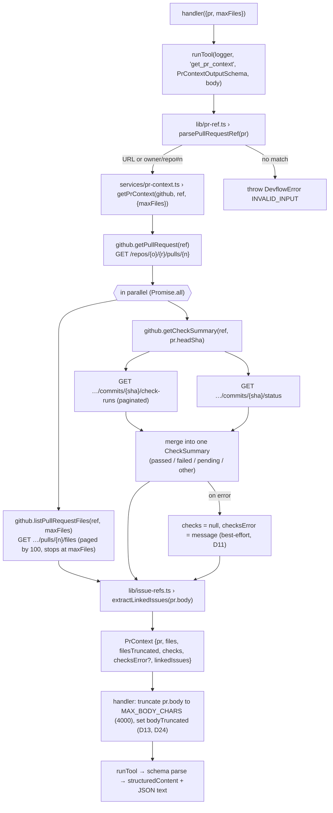

**Ordering detail:** `getPullRequest` must finish first because the CI lookup needs `pr.headSha`.
Files and CI are independent, so they run concurrently. CI failures are caught _inside_ the
`Promise.all` (via `.then(ok, fail)`) so they can't discard the file list.

## 5. `analyze_pr_risk`

**Entry:** `src/tools/analyze-pr-risk.ts › registerAnalyzePrRisk` handler · **Arguments:** `pr`

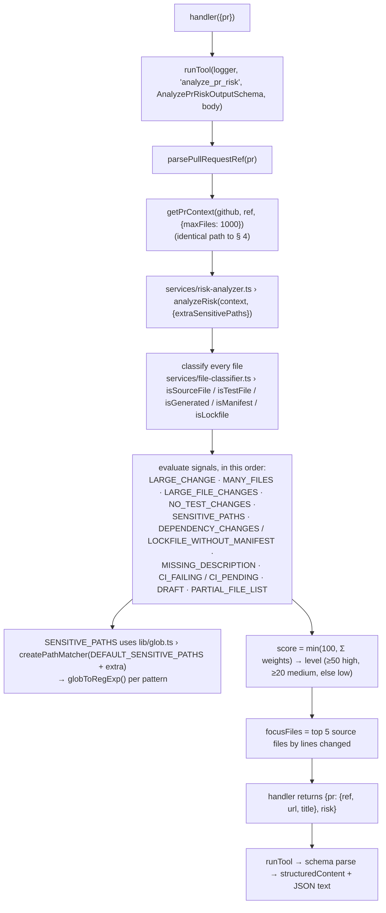

`analyzeRisk()` is **pure**: no I/O, no clock, no randomness, so the same input always gives the
same report (D12). All network work happens in the shared `getPrContext()` step. Its `focusFiles`
are designed to be passed straight to `get_pr_diff` (§ 6).

## 6. `get_pr_diff`

**Entry:** `src/tools/get-pr-diff.ts › registerGetPrDiff` handler · **Arguments:** `pr`, `paths?` (≤ 50 paths or globs), `maxChars` (1,000–80,000, default 20,000)

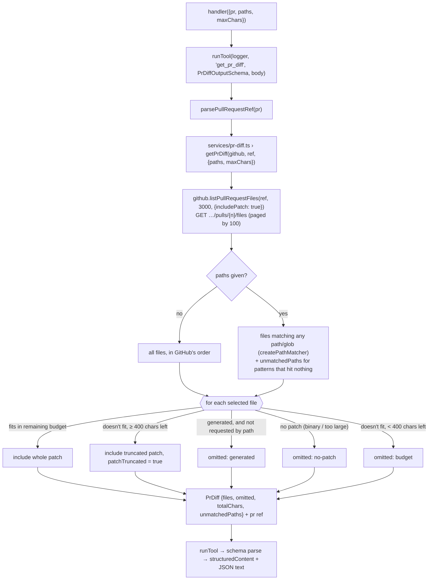

Everything the model did _not_ get is listed with a reason, so it can ask again with a larger
budget or narrower paths (D25).

## 7. `list_review_queue`

**Entry:** `src/tools/list-review-queue.ts › registerListReviewQueue` handler · **Arguments:** `repo?`, `limit` (1–30, default 10), `cursor?`

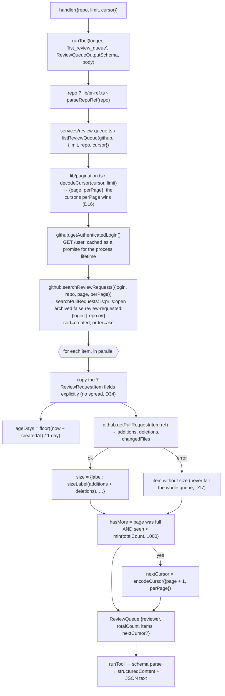

**Pagination round-trip:** the model passes `nextCursor` back as `cursor` and the flow repeats
from `decodeCursor`. The 1000-item cap exists because GitHub search refuses pages past 1000 results.

## 8. `get_my_activity`

**Entry:** `src/tools/get-my-activity.ts › registerGetMyActivity` handler · **Arguments:** `days` (1–31, default 1), `user?`, `repo?`

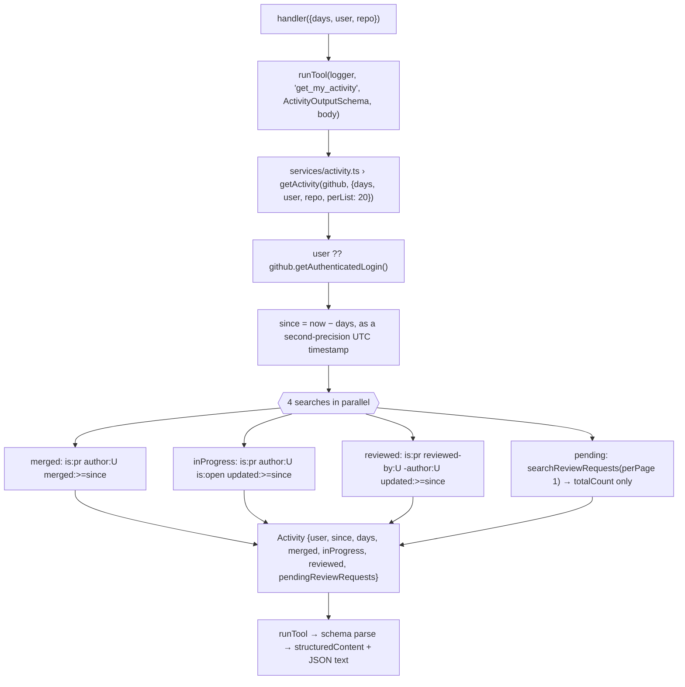

All four searches carry the optional `repo:` qualifier. "Reviewed" is an approximation; see D26.

## 9. `generate_release_notes`

**Entry:** `src/tools/generate-release-notes.ts › registerGenerateReleaseNotes` handler · **Arguments:** `repo`, `from`, `to?`, `base?`, `limit` (1–300, default 100)

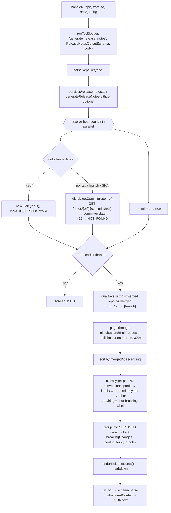

The window starts one second after `from` because the commit `from` points at belongs to the
previous release (D29).

## 10. Resources: list and read

Resources are **read**, not called: the host (or the user) asks for a URI and gets its content.
Failures surface as JSON-RPC errors via `runRequest()` (D32), not as `isError` results.

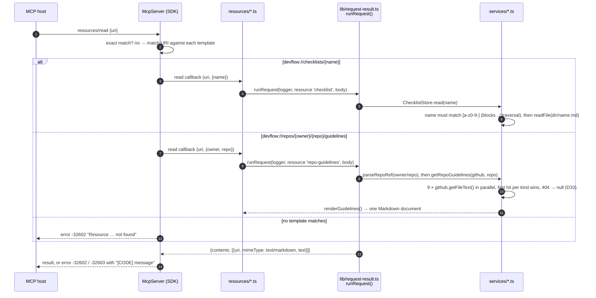

**Listing:** `resources/list` calls the checklist template's `list` callback, which reads the
folder each time. The guidelines template has no `list` callback because "all repositories" is not
a finite, useful list.

## 11. Prompts, and the `/review-pr` journey end to end

A prompt turns a user's slash-command into messages for the model (D30). `prompts/get` runs our
callback inside `runRequest()`. It validates the arguments, then returns instructions; only the
static checklist is embedded.

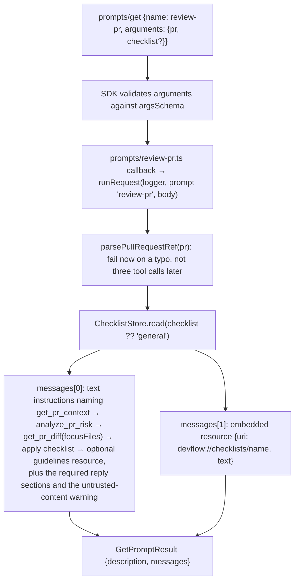

`/standup-summary` (`prompts/standup-summary.ts`) validates `days` (prompt arguments are always
strings) and points the model at `get_my_activity` and `list_review_queue`.
`/release-notes` (`prompts/release-notes.ts`) validates `repo` and points it at
`generate_release_notes`.

**The whole `/review-pr` journey**, which is what a demo shows:

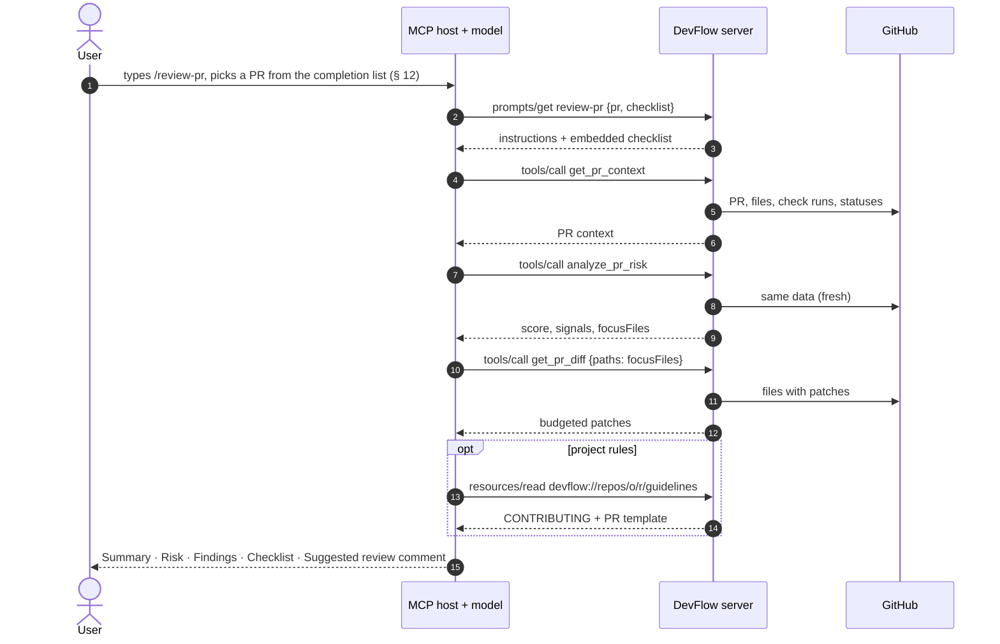

## 12. Argument completion

Hosts call `completion/complete` as the user types a prompt argument or a resource-template
variable. The SDK routes it to the completer attached with `completable()` or a template's `complete`.

| Ref                                    | Argument    | Completer                                                           | Data source                     |
| -------------------------------------- | ----------- | ------------------------------------------------------------------- | ------------------------------- |
| prompt `review-pr`                     | `pr`        | `ctx.suggestions.suggest(value)`, substring match on `owner/repo#n` | Review queue, cached 60 s (D31) |
| prompt `review-pr`                     | `checklist` | checklist names starting with `value`                               | `ChecklistStore.list()`         |
| prompt `release-notes`                 | `repo`      | unique `owner/repo` from the suggestions, substring match           | Review queue, cached 60 s       |
| prompt `standup-summary`               | `days`      | `1`, `3`, `7` starting with `value`                                 | static                          |
| template `devflow://checklists/{name}` | `name`      | checklist names starting with `value`                               | `ChecklistStore.list()`         |

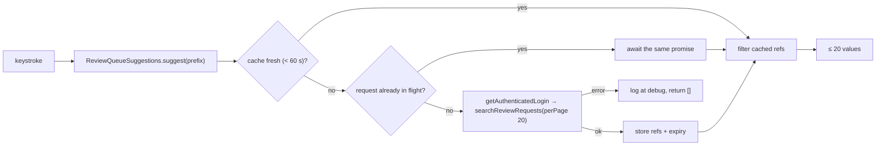

## 13. Logging to the host

Every log line goes to stderr; the bridge also offers it to the host as `notifications/message` (D28).

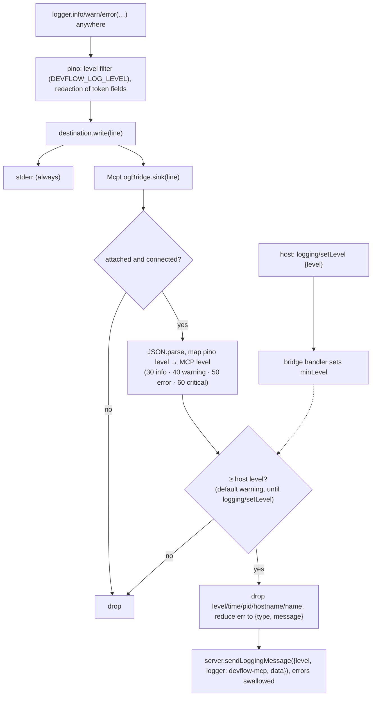

Two independent filters apply: `DEVFLOW_LOG_LEVEL` decides what is logged at all, and the host's
level decides what is forwarded to it.

## 14. Error paths

Where each kind of failure starts, and what the host sees in the end.

| #   | Trigger                                         | Raised at                                                                          | Becomes                                                            | Host sees                                                                   |
| --- | ----------------------------------------------- | ---------------------------------------------------------------------------------- | ------------------------------------------------------------------ | --------------------------------------------------------------------------- |
| E1  | Invalid env var, or no token and no `gh` login  | `loadConfig()` or `resolveGitHubToken()` → `ConfigError`                           | `main().catch` prints the message to stderr, `exit(1)`             | Server failed to start; message in the host's MCP logs says how to sign in  |
| E2  | Unknown tool name                               | SDK                                                                                | SDK tool error                                                     | `isError: true`, "Tool X not found"                                         |
| E3  | Tool arguments violate input schema             | SDK `validateToolInput`                                                            | SDK tool error                                                     | `isError: true`, "Input validation error: …"                                |
| E4  | Malformed PR/repo string, cursor or date        | `pr-ref.ts` / `pagination.ts` / `release-notes.ts` → `DevflowError(INVALID_INPUT)` | `runTool` catch                                                    | `isError: true`, `[INVALID_INPUT] …`                                        |
| E5  | GitHub 401/403/404/422/429/5xx                  | Octokit → `errors.ts › mapGitHubError()` in each client method                     | `DevflowError` with code → `runTool` catch                         | `isError: true`, e.g. `[NOT_FOUND] Could not find … Check …`                |
| E6  | Rate limited (quota, 429, or secondary limit)   | `mapGitHubError()` reads `x-ratelimit-*`, `retry-after` and the message            | `DevflowError(RATE_LIMITED)` with the reset time or wait           | `isError: true`, `[RATE_LIMITED] … resets at …` / `… Wait 60 seconds …`     |
| E7  | Unknown tag/branch/SHA in release notes         | `getCommit()`: 422 → `DevflowError(NOT_FOUND)`                                     | `runTool` catch                                                    | `isError: true`, `[NOT_FOUND] "v9" is not a tag, branch or commit in o/r.`  |
| E8  | CI lookup fails                                 | `getCheckSummary()`                                                                | Caught in `getPrContext()`, **not** an error                       | Success, with `checks: null` and `checksError` explaining why (D11)         |
| E9  | One PR's size lookup fails in the queue         | `getPullRequest()` inside `listReviewQueue()`                                      | Caught per item, **not** an error                                  | Success; that item has no `size` (D17)                                      |
| E10 | A guideline file is missing                     | `getFileText()`: 404 → `null`                                                      | **not** an error                                                   | Success; that section says "Not found" (D33)                                |
| E11 | Result has undeclared fields                    | service / client                                                                   | `runTool` › `outputSchema.parse` drops them                        | Success, with only the declared fields (D34)                                |
| E12 | Result lacks a required field                   | service / client bug                                                               | `outputSchema.parse` throws → `runTool` catch                      | `isError: true`, `[INTERNAL] …` (D34)                                       |
| E13 | Bug / unexpected exception in a tool            | anywhere                                                                           | `runTool` catch → `logger.error` with stack                        | `isError: true`, `[INTERNAL] Unexpected internal error…` (no internals, D8) |
| E14 | Bad resource URI or unknown checklist           | SDK (no template match) or `ChecklistStore.read()`                                 | `runRequest` → `McpError(-32602)`                                  | JSON-RPC error -32602, `[NOT_FOUND] No checklist named "x". Available: …`   |
| E15 | Bad prompt argument (PR ref, days, checklist)   | prompt callback → `DevflowError(INVALID_INPUT / NOT_FOUND)`                        | `runRequest` → `McpError(-32602)`                                  | JSON-RPC error -32602, `[INVALID_INPUT] …`                                  |
| E16 | Resource/prompt failure on GitHub or a bug      | services / client                                                                  | `runRequest` → `McpError(-32603)`, generic text for unknown errors | JSON-RPC error -32603, `[CODE] …` or `[INTERNAL] …`                         |
| E17 | Completion lookup fails                         | `ReviewQueueSuggestions.fetch()`                                                   | Caught, logged at debug                                            | Empty suggestion list (D31)                                                 |
| E18 | Log notification fails (e.g. host disconnected) | `sendLoggingMessage()`                                                             | Promise rejection swallowed                                        | Nothing; avoids log loops (D28)                                             |

Every tool failure goes through `runTool()`, and every resource or prompt failure through
`runRequest()`, so the `[CODE] message` format and the `warn`/`error` log fields are the same everywhere.

## 15. Shutdown

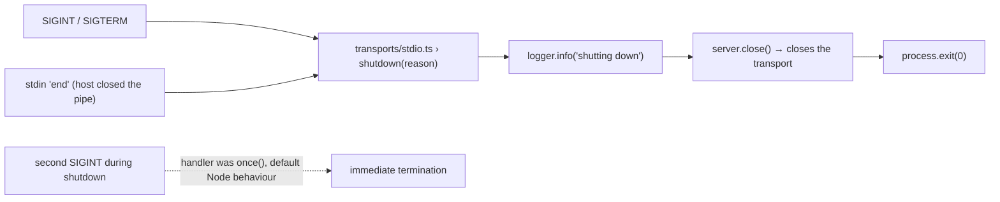

## 16. Test and tooling flows

The same production code runs under different wiring.

**Integration tests** (`test/integration/server.test.ts`)

```
FakeGitHubClient (test/helpers/fixtures.ts)       ─┐
createLogger('debug', bridge.sink, quiet stderr)  │
ChecklistStore(<repo>/checklists)                 ├─► createServer(ctx) ─► bridge.attach ─► server.connect
ReviewQueueSuggestions(fake, logger)              │                                             ▲
extraSensitivePaths: []                           ─┘          InMemoryTransport.createLinkedPair()
new Client() ─► connect ─► tools/list (like a real host, D34) ─► callTool / readResource /
                getPrompt / complete / setLoggingLevel  ── §§ 2–14 ──┘
```

This exercises everything in §§ 2–14 except `OctokitGitHubClient` and the stdio transport. The
fake returns the same shapes as the real client; a narrower fake once hid a bug (D34).

**Adapter tests** (`test/unit/github-client.test.ts`): `new OctokitGitHubClient()` → real Octokit →
native `fetch` → **msw** `setupServer()` returns canned GitHub JSON. This covers the bottom box of § 3.

**Live smoke** (`scripts/smoke.ts`, `npm run smoke -- <pr> [release-from]`): the SDK `Client` with
`StdioClientTransport` spawns `node dist/index.js` (§ 1). It calls all 6 tools, reads both kinds of
resource, gets `/review-pr`, and asks for a completion, all against real GitHub. It is the only
flow that covers the built artifact and stdio together, and it exits non-zero if anything fails.

**MCP Inspector** (`npm run inspect`): a manual, visual run of everything above.

## 17. GitHub API calls per operation

| Operation                         | Requests                                                                                                                | Typical total |
| --------------------------------- | ----------------------------------------------------------------------------------------------------------------------- | ------------- |
| `get_pr_context`                  | `pulls.get` ×1 · `pulls.listFiles` ×⌈files/100⌉ · `checks.listForRef` ×⌈runs/100⌉ · `repos.getCombinedStatusForRef` ×1  | 4             |
| `analyze_pr_risk`                 | Same as `get_pr_context` (up to 1000 files, so up to 10 file pages)                                                     | 4             |
| `get_pr_diff`                     | `pulls.listFiles` ×⌈files/100⌉ (with patches)                                                                           | 1             |
| `list_review_queue`               | `users.getAuthenticated` ×1 (first call per process only) · `search.issuesAndPullRequests` ×1 · `pulls.get` ×N (N ≤ 30) | 2 + N         |
| `get_my_activity`                 | `users.getAuthenticated` ×1 (cached; skipped if `user` is given) · `search.issuesAndPullRequests` ×4                    | 4–5           |
| `generate_release_notes`          | `repos.getCommit` ×0–2 (0 for dates) · `search.issuesAndPullRequests` ×⌈PRs/100⌉ (≤ 3)                                  | 2–5           |
| read `devflow://checklists/…`     | none (local files)                                                                                                      | 0             |
| read `…/repos/{o}/{r}/guidelines` | `repos.getContent` ×9 in parallel (most return 404)                                                                     | 9             |
| `prompts/get` (any)               | none                                                                                                                    | 0             |
| completion of `pr` / `repo`       | `search.issuesAndPullRequests` ×1, at most once per 60 s                                                                | 0–1           |

Budget: 5,000 core requests/hour and 30 search requests/minute for an authenticated user.

## 18. Function index

Who calls what. Use it to find the impact of changing a function.

| Function                                                                    | File                                  | Called by                                                     | Calls                                                                                                                                                                         |
| --------------------------------------------------------------------------- | ------------------------------------- | ------------------------------------------------------------- | ----------------------------------------------------------------------------------------------------------------------------------------------------------------------------- |
| `main`                                                                      | `src/index.ts`                        | Node (process start)                                          | `loadConfig`, `resolveGitHubToken`, `McpLogBridge`, `createLogger`, `OctokitGitHubClient`, `ChecklistStore`, `ReviewQueueSuggestions`, `createServer`, `attach`, `startStdio` |
| `loadConfig`                                                                | `src/config.ts`                       | `main`, tests                                                 | zod `EnvSchema.safeParse`                                                                                                                                                     |
| `resolveGitHubToken`                                                        | `src/config.ts`                       | `main`, tests                                                 | `execFile('gh', ['auth', 'token'])` via the injectable `RunCommand`                                                                                                           |
| `createLogger` / `createSilentLogger`                                       | `src/lib/logger.ts`                   | `main`, tests                                                 | pino; the optional sink                                                                                                                                                       |
| `McpLogBridge.attach` / `.sink`                                             | `src/lib/mcp-log-bridge.ts`           | `main`, integration tests / pino destination                  | `server.server.setRequestHandler`, `sendLoggingMessage`                                                                                                                       |
| `findPackageRoot`                                                           | `src/lib/package-root.ts`             | `main`, tests                                                 | `existsSync`                                                                                                                                                                  |
| `createServer`                                                              | `src/server.ts`                       | `main`, integration tests                                     | `McpServer`, all 11 `register*` functions                                                                                                                                     |
| `startStdio`                                                                | `src/transports/stdio.ts`             | `main`                                                        | `StdioServerTransport`, `server.connect`, `server.close`                                                                                                                      |
| `registerGetPrContext`                                                      | `src/tools/get-pr-context.ts`         | `createServer`                                                | handler → `runTool`, `parsePullRequestRef`, `getPrContext`                                                                                                                    |
| `registerAnalyzePrRisk`                                                     | `src/tools/analyze-pr-risk.ts`        | `createServer`                                                | handler → `runTool`, `parsePullRequestRef`, `getPrContext`, `analyzeRisk`                                                                                                     |
| `registerGetPrDiff`                                                         | `src/tools/get-pr-diff.ts`            | `createServer`                                                | handler → `runTool`, `parsePullRequestRef`, `getPrDiff`                                                                                                                       |
| `registerListReviewQueue`                                                   | `src/tools/list-review-queue.ts`      | `createServer`                                                | handler → `runTool`, `parseRepoRef`, `listReviewQueue`                                                                                                                        |
| `registerGetMyActivity`                                                     | `src/tools/get-my-activity.ts`        | `createServer`                                                | handler → `runTool`, `parseRepoRef`, `getActivity`                                                                                                                            |
| `registerGenerateReleaseNotes`                                              | `src/tools/generate-release-notes.ts` | `createServer`                                                | handler → `runTool`, `parseRepoRef`, `generateReleaseNotes`                                                                                                                   |
| `registerChecklistResources`                                                | `src/resources/checklists.ts`         | `createServer`                                                | list/complete → `ChecklistStore.list`; read → `runRequest`, `ChecklistStore.read`                                                                                             |
| `registerRepoGuidelinesResource`                                            | `src/resources/repo-guidelines.ts`    | `createServer`                                                | read → `runRequest`, `parseRepoRef`, `getRepoGuidelines`, `renderGuidelines`                                                                                                  |
| `registerReviewPrPrompt`                                                    | `src/prompts/review-pr.ts`            | `createServer`                                                | `runRequest`, `parsePullRequestRef`, `ChecklistStore.read`; completers → `suggest`, `ChecklistStore.list`                                                                     |
| `registerStandupSummaryPrompt`                                              | `src/prompts/standup-summary.ts`      | `createServer`                                                | `runRequest`, `parseRepoRef`                                                                                                                                                  |
| `registerReleaseNotesPrompt`                                                | `src/prompts/release-notes.ts`        | `createServer`                                                | `runRequest`, `parseRepoRef`; completer → `suggest`                                                                                                                           |
| `runTool`                                                                   | `src/lib/tool-result.ts`              | all six tool handlers                                         | the tool body; `outputSchema.parse`; `logger.info/warn/error`                                                                                                                 |
| `runRequest` / `singleValue`                                                | `src/lib/request-result.ts`           | resource read callbacks, prompt callbacks                     | the body; `McpError`; `logger.info/warn/error`                                                                                                                                |
| `getPrContext`                                                              | `src/services/pr-context.ts`          | `get_pr_context`, `analyze_pr_risk` handlers                  | `getPullRequest`, `listPullRequestFiles`, `getCheckSummary`, `extractLinkedIssues`                                                                                            |
| `analyzeRisk`                                                               | `src/services/risk-analyzer.ts`       | `analyze_pr_risk` handler                                     | `is*` classifiers, `createPathMatcher`                                                                                                                                        |
| `getPrDiff`                                                                 | `src/services/pr-diff.ts`             | `get_pr_diff` handler                                         | `listPullRequestFiles({includePatch})`, `createPathMatcher`, `isGenerated`                                                                                                    |
| `listReviewQueue` / `sizeLabel`                                             | `src/services/review-queue.ts`        | `list_review_queue` handler                                   | `decodeCursor`, `getAuthenticatedLogin`, `searchReviewRequests`, `getPullRequest`, `encodeCursor`                                                                             |
| `getActivity`                                                               | `src/services/activity.ts`            | `get_my_activity` handler                                     | `getAuthenticatedLogin`, `searchPullRequests` ×3, `searchReviewRequests`                                                                                                      |
| `generateReleaseNotes` / `classify` / `renderReleaseNotes`                  | `src/services/release-notes.ts`       | `generate_release_notes` handler                              | `getCommit`, `searchPullRequests`                                                                                                                                             |
| `getRepoGuidelines` / `renderGuidelines`                                    | `src/services/repo-guidelines.ts`     | guidelines resource                                           | `getFileText` ×9                                                                                                                                                              |
| `ChecklistStore.list` / `.read`                                             | `src/services/checklists.ts`          | checklist resource, `review-pr` prompt, completers            | `readdir`, `readFile`                                                                                                                                                         |
| `ReviewQueueSuggestions.suggest`                                            | `src/services/suggestions.ts`         | `review-pr` and `release-notes` completers                    | `getAuthenticatedLogin`, `searchReviewRequests` (cached)                                                                                                                      |
| `isSourceFile` / `isTestFile` / `isGenerated` / `isManifest` / `isLockfile` | `src/services/file-classifier.ts`     | `analyzeRisk`, `getPrDiff` (`isGenerated`)                    | regexes and sets in the same file                                                                                                                                             |
| `getAuthenticatedLogin`                                                     | `src/clients/github.ts`               | `listReviewQueue`, `getActivity`, `ReviewQueueSuggestions`    | `GET /user` (cached), `mapGitHubError`                                                                                                                                        |
| `getPullRequest`                                                            | `src/clients/github.ts`               | `getPrContext`, `listReviewQueue`                             | `GET /repos/{o}/{r}/pulls/{n}`, `mapGitHubError`                                                                                                                              |
| `listPullRequestFiles`                                                      | `src/clients/github.ts`               | `getPrContext`, `getPrDiff`                                   | `GET …/pulls/{n}/files` (iterator), `mapGitHubError`                                                                                                                          |
| `getCheckSummary`                                                           | `src/clients/github.ts`               | `getPrContext`                                                | `GET …/check-runs`, `GET …/status`, `mapGitHubError`                                                                                                                          |
| `getCommit`                                                                 | `src/clients/github.ts`               | `generateReleaseNotes`                                        | `GET …/commits/{ref}`; 422 → `NOT_FOUND`                                                                                                                                      |
| `getFileText`                                                               | `src/clients/github.ts`               | `getRepoGuidelines`                                           | `GET …/contents/{path}`; 404 → `null`                                                                                                                                         |
| `searchPullRequests`                                                        | `src/clients/github.ts`               | `getActivity`, `generateReleaseNotes`, `searchReviewRequests` | `GET /search/issues`, `mapGitHubError`                                                                                                                                        |
| `searchReviewRequests`                                                      | `src/clients/github.ts`               | `listReviewQueue`, `getActivity`, `ReviewQueueSuggestions`    | `searchPullRequests`                                                                                                                                                          |
| `mapGitHubError`                                                            | `src/lib/errors.ts`                   | every `OctokitGitHubClient` method                            | creates `DevflowError`                                                                                                                                                        |
| `parsePullRequestRef` / `parseRepoRef`                                      | `src/lib/pr-ref.ts`                   | tool handlers, resource callbacks, prompt callbacks           | regexes; throws `DevflowError(INVALID_INPUT)`                                                                                                                                 |
| `formatPullRequestRef`                                                      | `src/lib/pr-ref.ts`                   | client error messages, `review-pr` prompt, suggestions        | none                                                                                                                                                                          |
| `extractLinkedIssues`                                                       | `src/lib/issue-refs.ts`               | `getPrContext`                                                | regex over the PR body                                                                                                                                                        |
| `encodeCursor` / `decodeCursor`                                             | `src/lib/pagination.ts`               | `listReviewQueue`                                             | base64url JSON                                                                                                                                                                |
| `createPathMatcher` / `globToRegExp`                                        | `src/lib/glob.ts`                     | `analyzeRisk`, `getPrDiff`                                    | none                                                                                                                                                                          |

> **Keep this file current:** when a milestone adds a tool, resource or prompt, add a section in
> the style of §§ 4–11, rows to §§ 14 and 17, and rows to § 18.
